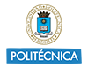

# Advisory Board

---

The find.software advisory board was established on Nov. 19 2026. Our collaboration is based on our [Advisory Board Agreement](../supplements/Advisory-board-agreement.pdf).

---

## Current Members

{:class="no-shadow", width="80", align="right", style="margin: 0px 0 0 0"}

- Daniel Garijo [{:class="no-shadow", width="20"}](https://orcid.org/0000-0003-0454-7145) ([Universidad Politécnica de Madrid](https://www.upm.es/))

 

{:class="no-shadow", width="80", align="right", style="margin: 0px 0 0 0}

- Deepesha Burse ([Wikimedia Germany](https://www.wikimedia.de))

 

{:class="no-shadow", width="80", align="right", style="margin: 0px 0 0 0"}

- Florian Mannseicher  [{:class="no-shadow", width="20"}](https://orcid.org/0000-0002-0563-1763) ([deRSE](https://de-rse.org) and [FutuRSI](https://www.futursi.de/))

--- 

## Meetings

[2026-11-05 Inaugural Meeting](../supplements/20261105-Inaugural-meeting-protocol.pdf)